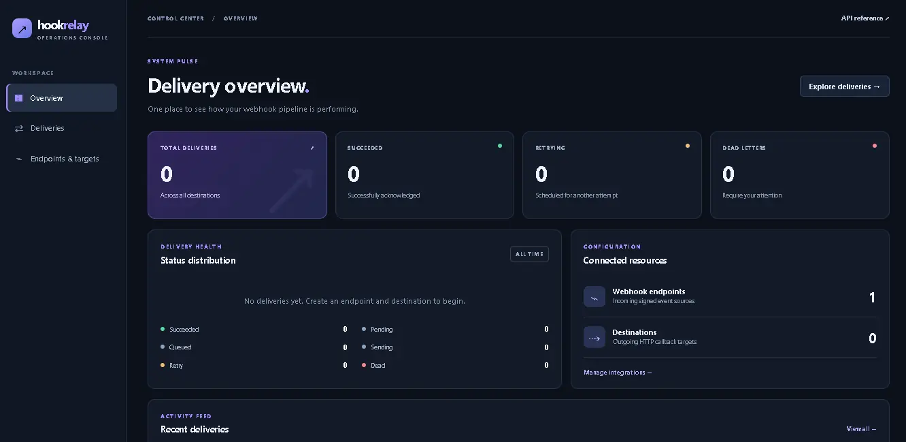
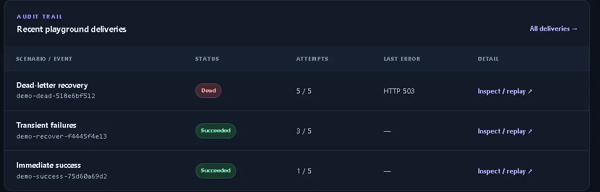
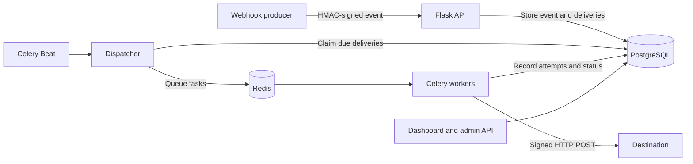

# HookRelay

[](https://github.com/carinotj19/HookRelay/actions/workflows/ci.yml)

A webhook relay built with **Python and Flask**. HookRelay receives signed events, stores them durably, and forwards them to HTTP destinations with retry handling, delivery history, and manual replay.

The project includes a web dashboard, an interactive API reference, and a local playground for testing webhook failures without setting up a message broker.

## Features

- **Signed webhooks** — HMAC-SHA256 verification with timestamp validation.
- **Idempotent ingestion** — duplicate event IDs are detected before creating new deliveries.
- **Reliable delivery** — PostgreSQL-backed outbox, Celery workers, Redis, and exponential retries.
- **Delivery history** — track HTTP responses, errors, attempts, and delivery status.
- **Dead-letter replay** — retry terminal deliveries without losing their original audit history.
- **Admin dashboard and API** — manage endpoints, inspect deliveries, and explore the API with Swagger UI.
- **Local playground** — simulate successful, failing, and recovered callbacks using real HTTP requests.

## Screenshots

**Dashboard overview**



**Local playground: recorded delivery outcomes**



The second screenshot shows the dead-letter state before an operator replays it. Both are from a local demonstration, not a hosted production system.

## Tech stack

| Component | Technology |
| --- | --- |
| Backend | Python 3.11+, Flask |
| Database | PostgreSQL, SQLAlchemy, Alembic |
| Background tasks | Celery, Redis |
| Dashboard | Flask, Jinja, CSS |
| API documentation | OpenAPI 3.0, Swagger UI |
| Tests and CI | pytest, GitHub Actions |
| Container setup (optional) | Docker Compose |

## Getting started

### Local development (no Docker)

The dashboard, API, and interactive playground can run with **Python and SQLite**. This is the quickest way to explore HookRelay; it does not start the production Celery/Redis worker pipeline.

**Windows PowerShell**

```powershell
# Clone and install
git clone https://github.com/carinotj19/HookRelay.git
cd HookRelay
py -m venv .venv
.\.venv\Scripts\Activate.ps1
python -m pip install -e ".[test]"

# Local-only configuration
$env:ADMIN_API_KEY = "change-this-local-admin-key"
$env:DASHBOARD_SESSION_SECRET = python -c "import secrets; print(secrets.token_hex(32))"
$env:DATABASE_URL = "sqlite:///hookrelay-docs.db"
$env:LOCAL_PLAYGROUND_ENABLED = "1"

# Initialize the database and start Flask
python -m alembic upgrade head
python -m flask --app hookrelay run --host 127.0.0.1 --port 8000 --with-threads
```

**macOS / Linux**

```bash
git clone https://github.com/carinotj19/HookRelay.git
cd HookRelay
python3 -m venv .venv
source .venv/bin/activate
python -m pip install -e '.[test]'

export ADMIN_API_KEY='change-this-local-admin-key'
export DASHBOARD_SESSION_SECRET="$(python -c 'import secrets; print(secrets.token_hex(32))')"
export DATABASE_URL='sqlite:///hookrelay-docs.db'
export LOCAL_PLAYGROUND_ENABLED=1

python -m alembic upgrade head
python -m flask --app hookrelay run --host 127.0.0.1 --port 8000 --with-threads
```

Open one of these pages after starting Flask:

| Page | URL |
| --- | --- |
| Dashboard | <http://127.0.0.1:8000/dashboard> |
| Local delivery playground | <http://127.0.0.1:8000/dashboard/playground> |
| Swagger UI | <http://127.0.0.1:8000/docs> |
| OpenAPI specification | <http://127.0.0.1:8000/openapi.json> |

Sign in to the dashboard with the `ADMIN_API_KEY` value you configured. The same key is used as a bearer token for administrative API requests. Keep both secrets out of source control. For a persistent setup, store a stable `DASHBOARD_SESSION_SECRET`; changing it invalidates existing dashboard sessions.

> **Note:** These commands run the Flask development server, bound to localhost. Do not use this setup as a public deployment.

### Try the delivery playground

The playground uses real, signed HTTP requests and stores delivery attempts in your local database. No Redis or Docker is required.

1. Open **Dashboard → Local playground** and select **Initialize playground**.
2. Use **Send signed event** to create events for the available scenarios.
3. Select **Advance one step** to process the demo deliveries and observe their status changes.
4. Open **Deliveries** to inspect HTTP attempts or replay a dead-letter delivery.

| Scenario | Expected result |
| --- | --- |
| Immediate success | HTTP 204 on the first attempt |
| Transient failure | HTTP 503 twice, followed by HTTP 204 |
| Dead-letter recovery | Repeated HTTP 503 responses until `dead`, then a successful replay |

The playground deliberately skips *waiting* for retry deadlines on its own demo records. It uses the real ingestion and delivery logic, but **manual advancement is not a substitute for Celery/Redis background processing**. The playground is disabled by default unless `LOCAL_PLAYGROUND_ENABLED=1`, and its routes require loopback access.

### Full stack with Docker Compose (optional)

For a PostgreSQL + Redis + Celery setup, copy `.env.example` to `.env` and configure strong, matching database credentials and application secrets. Then run:

```bash
docker compose up -d db redis
docker compose run --rm api alembic upgrade head
docker compose up --build -d api worker beat
```

The API is available at <http://127.0.0.1:8000>. The Compose configuration binds it to localhost. See `.env.example` for configuration options.

## How it works



Events and their delivery records are committed to the database **before** tasks are queued. The dispatcher picks up due records, including recoverable expired leases. Workers record each delivery attempt and schedule another attempt after a failure, up to the configured limit. Terminal deliveries can be replayed as new records linked to the original.

**Delivery is at least once, not exactly once.** A receiver might process a request before HookRelay records its success. Consumers should deduplicate events or delivery IDs as appropriate; replay creates a new delivery ID.

## API

Interactive documentation is available at [`/docs`](http://127.0.0.1:8000/docs), with the OpenAPI document at [`/openapi.json`](http://127.0.0.1:8000/openapi.json).

| Method | Endpoint | Description |
| --- | --- | --- |
| `GET` | `/health/live` | Liveness check |
| `GET` | `/health/ready` | Database readiness check |
| `POST` | `/api/v1/endpoints` | Create an incoming webhook endpoint |
| `GET` | `/api/v1/endpoints` | List endpoints |
| `POST` | `/api/v1/destinations` | Add an outbound destination |
| `GET` | `/api/v1/destinations` | List destinations |
| `POST` | `/hooks/{public_key}` | Ingest an HMAC-signed event |
| `GET` | `/api/v1/events` | List ingested events |
| `GET` | `/api/v1/deliveries` | List deliveries, optionally filtered by status |
| `GET` | `/api/v1/deliveries/{id}/attempts` | View delivery attempts |
| `POST` | `/api/v1/deliveries/{id}/replay` | Replay a terminal delivery |
| `GET` | `/api/v1/stats` | Delivery status counts |

Admin endpoints require `Authorization: Bearer <ADMIN_API_KEY>`. Incoming webhooks require `X-HookRelay-Event-Id` and `X-HookRelay-Signature`. The signature covers the timestamp and exact raw request body. Endpoint and destination signing secrets are returned on creation, not on list requests.

## Running tests

```bash
python -m pytest --cov=hookrelay --basetemp=./.pytest-tmp
python -m hookrelay.reliability_demo
```

The test suite includes API, security, retry, replay, dashboard, and real-loopback HTTP tests. GitHub Actions runs the suite on Linux and Windows, plus separate integration tests against PostgreSQL with Alembic migrations. PostgreSQL-only tests are skipped locally when `HOOKRELAY_TEST_POSTGRES_URL` is not configured.

## Project structure

```text
hookrelay/       Flask application, routes, dashboard, and delivery logic
  templates/     Dashboard and Swagger UI templates
  static/        Dashboard styles and OpenAPI document
migrations/      Alembic database migrations
tests/           Unit and integration tests
.github/workflows/  CI configuration
compose.yaml     Optional full-stack services
```

## Limitations

HookRelay is a development and portfolio project, not a production-ready multi-tenant webhook service. Before exposing it to untrusted users, it needs stronger SSRF/DNS-rebinding protection, rate limiting, secret rotation and encryption, observability, and more complete Redis/Celery process-failure testing. The dashboard currently uses a single admin key rather than individual user accounts or role-based access control.
