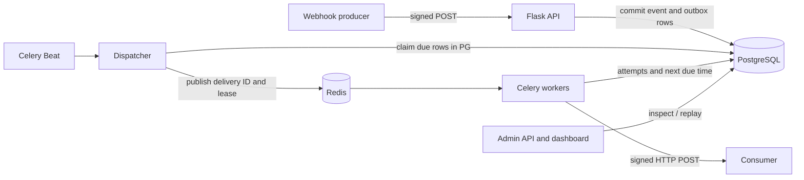

# HookRelay

**A durable webhook ingestion and delivery platform, built with Python and Flask.** A portfolio project showcasing failure-aware API design: HMAC verification, idempotent ingestion, a PostgreSQL outbox, async Celery delivery, exponential backoff, dead-letter state, auditable attempts, manual replay, and a server-rendered Flask operations dashboard.

> **Guarantee:** at-least-once attempts, not exactly-once delivery. Receiving systems must deduplicate using `X-HookRelay-Delivery-Id` (for attempts within a delivery) or their own event semantics. Replays intentionally get a new delivery ID but keep the same event ID.

## Architecture



The important boundary is **commit before enqueue**. Flask can accept a webhook while Redis is down. The periodic dispatcher finds committed `pending`/`retry` records and expired `queued`/`sending` leases. PostgreSQL `FOR UPDATE SKIP LOCKED` prevents dispatchers from claiming the same row simultaneously. Worker fencing tokens prevent stale tasks from updating newer state.

## Features

| Capability | Implementation |
|---|---|
| Signed ingress | HMAC-SHA256 over `timestamp + "." + raw_body`; constant-time compare; 5-minute clock window |
| Idempotency | Unique `(endpoint_id, X-HookRelay-Event-Id)`; exact duplicate `200`; conflicting payload `409` |
| Async delivery | Durable DB outbox + Redis/Celery worker and Beat |
| Retries | Up to 5 tries, exponential backoff with bounded jitter; HTTP non-2xx and network failures are retryable |
| Dead letters | Terminal `dead` status, preserved attempts and error summaries |
| Replay | Creates a *new* delivery linked via `replay_of_id`; originals and attempt histories remain unchanged |
| Operations | Health routes, authenticated JSON endpoints, event/attempt list, delivery status filters, summary counts |
| Dashboard | Flask/Jinja server-rendered overview, signed admin login, filterable delivery history, attempt timelines, replay forms, endpoint/destination creation |
| CI | pytest and coverage on Linux and Windows, real-PostgreSQL integration, and a Docker-free reliability smoke demo in GitHub Actions |

## Verify reliability without Docker (Windows, macOS, Linux)

**No PostgreSQL, Redis, Celery worker, or Docker installation is needed** for this verified local demonstration. It creates an isolated temporary SQLite database, uses the actual Flask API and delivery code, and sends signed HTTP requests to a short-lived receiver on `127.0.0.1`.

```powershell
# PowerShell, from the repository root
py -m venv .venv
.\.venv\Scripts\Activate.ps1
python -m pip install -e ".[test]"
python -m pytest --cov=hookrelay -v --basetemp=.\.pytest-tmp
python -m hookrelay.reliability_demo
```

The demo explicitly disposes its SQLite database connection pool before deleting the temporary files (needed for Windows). CI also runs the no-Docker test suite and HTTP demo on `windows-latest` to detect platform-specific regressions.

The demo prints verified checkpoints for signed ingestion + duplicate/conflicting IDs, real HTTP 503→retry→204, dead-letter exhaustion and replay, expired worker lease fencing, and HMAC-authenticated outbound requests. Retry due-times are advanced **inside the temporary demo database** so the demo can run quickly without waiting for backoff.

**Scope:** This verifies the Flask/API/SQLAlchemy/HTTP delivery behavior and task wrappers (Celery eager mode in tests). It is **not** a live Redis/Celery-worker run or proof of PostgreSQL concurrency. Real PostgreSQL migration, competing dispatcher, broker failure, lease recovery, and replay tests run in the separate GitHub Actions `postgres-integration` job. A real distributed outage test remains future work.

## Run locally (Docker)

1. Copy `.env.example` to `.env`. Set matching, strong values for `POSTGRES_PASSWORD` in both the password and the `DATABASE_URL`, and set a long random `ADMIN_API_KEY`.
2. Start dependencies: `docker compose up -d db redis`.
3. Apply schema migrations: `docker compose run --rm api alembic upgrade head`.
4. Start API and workers: `docker compose up --build -d api worker beat`.
5. Check: `curl http://127.0.0.1:8000/health/ready`.

The API binds to **localhost only** by default. Redis and Postgres are internal Compose services. Set `ALLOW_PRIVATE_DESTINATIONS=1` **only** if you intentionally want to target another container while demoing locally; the secure default requires HTTPS and rejects obviously local addresses. For real deployments, add DNS-pinning/egress-firewall protection against SSRF and DNS rebinding, TLS termination, rate limits, durable log retention, metrics, secret encryption/rotation, and a multi-user auth model before exposing this service to untrusted tenants.

## End-to-end demo

Replace `$ADMIN` with your actual token (PowerShell: `$ADMIN = 'your-api-key'`). Create a source and a destination via the admin API:

```bash
curl -s http://127.0.0.1:8000/api/v1/endpoints \
  -H "Authorization: Bearer $ADMIN" -H 'Content-Type: application/json' \
  -d '{"name":"billing-events"}'

curl -s http://127.0.0.1:8000/api/v1/destinations \
  -H "Authorization: Bearer $ADMIN" -H 'Content-Type: application/json' \
  -d '{"endpoint_id":"<ENDPOINT_UUID>","name":"receiver","url":"https://example.org/webhooks"}'
```

Both creation responses return the respective `signing_secret` **once** (later reads never return it). Never put these secrets in source control. Configure a real callback URL under your control; example.org is only a placeholder.

Sign a JSON body with the *endpoint* secret and send it. The following self-contained Python snippet uses the standard library and `requests`:

```python
import json, requests
from hookrelay.security import sign

host = "http://127.0.0.1:8000"
public_key = "<ENDPOINT_PUBLIC_KEY>"
secret = "<ENDPOINT_SIGNING_SECRET>"
body = json.dumps({"type": "invoice.paid", "invoice_id": "inv_123"}).encode()
response = requests.post(f"{host}/hooks/{public_key}", data=body, headers={
    "Content-Type": "application/json",
    "X-HookRelay-Event-Id": "evt_invoice_123",
    "X-HookRelay-Signature": sign(secret, body),
})
print(response.status_code, response.json())
```

Then inspect (with your admin bearer token):

```text
GET  /api/v1/events
GET  /api/v1/deliveries?status=retry
GET  /api/v1/deliveries/<id>/attempts
GET  /api/v1/stats
POST /api/v1/deliveries/<id>/replay
```

**To demonstrate failure:** point a destination at a controlled HTTPS endpoint that returns 503; observe the retry schedule, eventual `dead` state, and manual replay after restoring the endpoint. `POST /replay` only accepts terminal (`dead` or `succeeded`) deliveries.

## Developer workflow

```bash
python -m venv .venv
# Activate the virtual environment (e.g. .venv\\Scripts\\Activate.ps1 on Windows)
pip install -e '.[test]'
pytest --cov=hookrelay
```

Tests create an isolated SQLite database for fast deterministic execution. **SQLite is not a substitute for PostgreSQL concurrency testing** (`SKIP LOCKED` is PostgreSQL-specific). GitHub Actions also runs real PostgreSQL migration, concurrency and failure-injection integration tests. Full broker/worker-process outage tests are still needed before calling this production ready.

## Reliability contract and limitations

- A `202` means the *database transaction was committed*, **not** that the receiver got the event.
- Re-delivery is possible if an HTTP response was delivered but the worker died before persisting success. Clients must be idempotent.
- The dispatcher retries expired worker leases and lost broker publishes. Keep the lease longer than HTTP timeout; production deployments must constrain worker execution time as well.
- Every callback attempt has an immutable attempt record while its delivery retains status and schedule. Crash-before-record attempts are not observable locally, even though the receiver may have seen the call.
- Payload bytes are preserved so delivery signatures refer to the original bytes. Secrets and payloads reside in the database; this initial implementation assumes a trusted single-admin environment.
- This starter deliberately omits multi-tenancy, encrypted secrets, per-destination rate limiting, DNS-pinned SSRF defenses, metrics exporters, and retention jobs. They're follow-on milestones, not claimed features.

## Next milestones

1. Full Redis/Celery broker + worker-process outage tests (including crash after consumer accepts request), plus safe DNS-pinned egress.
2. Multi-tenant account and token lifecycle, audit trails, safe callback URL egress policy.
3. Prometheus metrics/OpenTelemetry tracing and live-updating dashboard visualization.
4. Scalable leased-dispatch scheduling, rate-limits, circuit breakers, backpressure, retention.

**Portfolio talking point:** explain why an outbox in PostgreSQL closes the DB→broker loss window, why leases recover worker crashes, and why replay needs separate audit history. These are the hard parts—not merely returning HTTP 200.

## Interactive API reference (no Docker required)

HookRelay serves a **Swagger UI reference at `/docs`** and a machine-readable **OpenAPI 3.0 specification at `/openapi.json`**. The specification covers all 12 Flask API operations, status codes, bearer authentication, incoming HMAC signatures, request fields, responses, and example payloads. The `openapi-spec-validator` test dependency validates it in CI; a route-coverage test catches endpoints that haven't been documented.

You can explore the API using **Python and temporary local SQLite** without PostgreSQL, Redis, Docker, or Celery workers. In PowerShell from the repository root:

```powershell
# One-time install (only if you haven't installed the test extras yet)
python -m pip install -e ".[test]"

# Set a local-only token; don't use this example value in a deployment.
$env:ADMIN_API_KEY = "local-demo-key-replace-me"
$env:DATABASE_URL = "sqlite:///hookrelay-docs.db"

# Create the local database schema (once)
python -m alembic upgrade head

# Start Flask; open http://127.0.0.1:8000/docs in your browser
python -m flask --app hookrelay run --host 127.0.0.1 --port 8000
```

In Swagger UI, use **Authorize** to enter the `ADMIN_API_KEY` token (not the literal `Bearer` prefix) for `/api/v1/*` calls. Create an endpoint and observe its signing secret: **save it securely**, because list endpoints do not return secrets. Creating a destination requires a URL you control; `https://example.org/webhooks` in example responses is illustrative, not a working receiver.

**Signed ingress:** To exercise `POST /hooks/{public_key}` you must calculate `X-HookRelay-Signature` over the **exact bytes** Swagger UI will send. The browser cannot automatically sign an edited request body. The Python signing example above is the most reliable way to send a signed event. The `X-HookRelay-Event-Id` header is required, and only identical repeated raw payloads with the same ID are deduplicated.

**Important:** `/docs` and `/openapi.json` are deliberately public reference pages, not live demo credentials. Swagger UI loads JavaScript and CSS from jsDelivr, so the browser needs internet access and you should not enter production admin tokens into an unreviewed deployment. For the actual worker pipeline, Redis/Celery and PostgreSQL are still recommended; this local SQLite server demonstrates HTTP API operations but **will not deliver queued webhooks automatically** without a running dispatcher and worker. Use `python -m hookrelay.reliability_demo` for a Docker-free signed HTTP delivery and recovery demonstration.


## Operations dashboard — no Docker required

HookRelay includes a small **Flask/Jinja dashboard** at **`/dashboard`**. It uses server-side queries and HTML templates (no React, Node, or frontend build tooling), with an overview of delivery states, resource counts, searchable/filterable paginated delivery records, attempt timelines, terminal delivery replay, and endpoint/destination registration. The existing JSON API continues to require a bearer token independently of dashboard sessions.

**Windows PowerShell quick start** (this assumes you already installed HookRelay and have a local SQLite schema from the Swagger walkthrough):

```powershell
# Stop the existing Flask dev server with Ctrl+C first, then:
git fetch origin
git switch feat/delivery-monitoring-dashboard
python -m pip install -e ".[test]"
$env:ADMIN_API_KEY = "local-demo-key-replace-me"
$env:DATABASE_URL = "sqlite:///hookrelay-docs.db"
$env:DASHBOARD_SESSION_SECRET = python -c "import secrets; print(secrets.token_hex(32))"
python -m alembic upgrade head
python -m flask --app hookrelay run --host 127.0.0.1 --port 8000
```

Open **http://127.0.0.1:8000/dashboard** in your browser and sign in with the `ADMIN_API_KEY` value. To reuse the earlier `Portfolio Demo` endpoint from Swagger, keep the same `DATABASE_URL` (Flask stores relative SQLite paths in its instance directory). Swagger UI remains available at `/docs`. If you use a different database or have no delivery records, the dashboard correctly shows empty states; **a bare Flask development server does not start Redis or Celery**. Run `python -m hookrelay.reliability_demo` independently for a Docker-free end-to-end signed HTTP demonstration (it uses its own isolated database and doesn't populate your dashboard).

**Session and security model:** The dashboard refuses to start without a separate, stable, **32+ character** `DASHBOARD_SESSION_SECRET`. Generate and save a strong secret in your deployment environment; a new secret invalidates all sessions. It never stores the raw admin key in the session. It uses a signed, HttpOnly, SameSite=Strict cookie with a 45-minute expiration and requires CSRF tokens for mutation and logout forms. HTML responses disable browser caching and framing. Creation pages reveal signing secrets once with no-store headers. Set `DASHBOARD_COOKIE_SECURE=1` behind HTTPS, require HTTPS for remote access, and keep `/dashboard` private. This is a **single-admin portfolio console**: it does not yet offer individual accounts, MFA, login rate limits, an operator audit trail, or RBAC. Do not expose it to the public internet as a multi-user SaaS service.

**Developer tests:** `python -m pytest tests/test_dashboard.py -v --basetemp=./.pytest-tmp` exercises authorization isolation, CSRF, key rotation, secret visibility, forms, status/search filters, pagination, attempt history and replay. Linux, Windows, and PostgreSQL CI checks continue to run automatically.

## Local delivery playground (Windows, no Docker)

The optional **local delivery playground** walks through signed ingestion,
HTTP 204 success, HTTP 503 retry recovery, dead-letter creation, and replay.
It runs real outgoing HTTP requests back to the **threaded local Flask server**
and verifies their outbound HMAC signatures. All attempts are stored in your
local SQLite database. **No Redis, Celery, or Docker is required for this demo.**

From the repository directory in PowerShell:

```powershell
.\.venv\Scripts\Activate.ps1
$env:ADMIN_API_KEY = "local-demo-key-replace-me"
$env:DATABASE_URL = "sqlite:///hookrelay-docs.db"
$env:DASHBOARD_SESSION_SECRET = python -c "import secrets; print(secrets.token_hex(32))"
$env:LOCAL_PLAYGROUND_ENABLED = "1"
python -m alembic upgrade head
python -m flask --app hookrelay run --host 127.0.0.1 --port 8000 --with-threads
```

Open <http://127.0.0.1:8000/dashboard/playground>, sign in with the admin
key, and follow these steps:

1. **Initialize playground** creates three isolated demo endpoint/receiver pairs.
   This is safe to click again if you restart Flask on a different port.
2. **Send signed event** under each scenario; this calls the real `/hooks/<public_key>`
   API with a valid per-source HMAC. The delivery is stored as `pending`.
3. **Advance one step** to send HTTP requests to local receiver endpoints. For
   *Transient failures*, click three times to see `retry`, `retry`, `succeeded`.
   For *Dead-letter recovery*, keep advancing until the configured attempt limit
   is reached and the delivery becomes `dead`.
4. Open the delivery detail to inspect response codes/timings. Click **Replay**
   on a dead letter; the replay becomes a new `pending` record, linked to the
   original for auditing. Advance again to process it; the demo receiver now
   returns HTTP 204 on replay to represent a recovered remote service.

The **Advance one step** action intentionally bypasses the *waiting period*
for retries **only on demo records**. The actual exponential-backoff algorithm
remains unchanged; this is simulated time for interview demonstrations.
The core dispatcher is scoped to the demo delivery IDs, so it cannot accidentally
process unrelated pending deliveries.

**Security and scope:** `LOCAL_PLAYGROUND_ENABLED` defaults to off. The routes
require both client and Host to be loopback; dashboard actions additionally require
an authenticated session and CSRF tokens. The signed local receiver rejects
invalid signatures. The demo uses a narrowly scoped private URL override rather
than enabling private destinations globally. Run Flask bound only to
`127.0.0.1`; never expose the dev server publicly. The receiver operates within
the same Flask process, so `--with-threads` is required. This does **not** test
Redis/Celery outages, the independent PostgreSQL scheduler, or production egress
security, and does **not** represent background processing.
