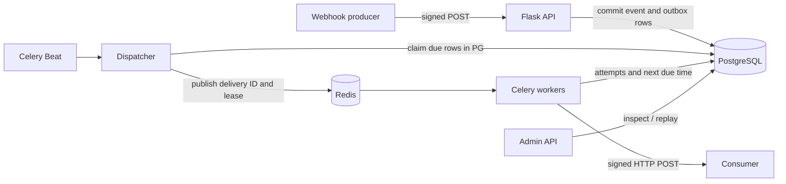

# HookRelay

**A durable webhook ingestion and delivery platform, built with Python and Flask.** A portfolio project showcasing failure-aware API design: HMAC verification, idempotent ingestion, a PostgreSQL outbox, async Celery delivery, exponential backoff, dead-letter state, auditable attempts, and manual replay.

> **Guarantee:** at-least-once attempts, not exactly-once delivery. Receiving systems must deduplicate using `X-HookRelay-Delivery-Id` (for attempts within a delivery) or their own event semantics. Replays intentionally get a new delivery ID but keep the same event ID.

## Architecture



The important boundary is **commit before enqueue**. Flask can accept a webhook while Redis is down. The periodic dispatcher finds committed `pending`/`retry` records and expired `queued`/`sending` leases. PostgreSQL `FOR UPDATE SKIP LOCKED` prevents dispatchers from claiming the same row simultaneously. Worker fencing tokens prevent stale tasks from updating newer state.

## Features

| Capability | Implementation |
|---|---|
| Signed ingress | HMAC-SHA256 over `timestamp + "." + raw_body`; constant-time compare; 5-minute clock window |
| Idempotency | Unique `(endpoint_id, X-HookRelay-Event-Id)`; exact duplicate `200`; conflicting payload `409` |
| Async delivery | Durable DB outbox + Redis/Celery worker and Beat |
| Retries | Up to 5 tries, exponential backoff with bounded jitter; HTTP non-2xx and network failures are retryable |
| Dead letters | Terminal `dead` status, preserved attempts and error summaries |
| Replay | Creates a *new* delivery linked via `replay_of_id`; originals and attempt histories remain unchanged |
| Operations | Health routes, authenticated JSON endpoints, event/attempt list, delivery status filters, summary counts |
| CI | pytest, coverage, real-PostgreSQL integration, and a Docker-free reliability smoke demo in GitHub Actions |

## Verify reliability without Docker (Windows, macOS, Linux)

**No PostgreSQL, Redis, Celery worker, or Docker installation is needed** for this verified local demonstration. It creates an isolated temporary SQLite database, uses the actual Flask API and delivery code, and sends signed HTTP requests to a short-lived receiver on `127.0.0.1`.

```powershell
# PowerShell, from the repository root
py -m venv .venv
.\.venv\Scripts\Activate.ps1
python -m pip install -e ".[test]"
python -m pytest --cov=hookrelay -v --basetemp=.\.pytest-tmp
python -m hookrelay.reliability_demo
```

The demo prints verified checkpoints for signed ingestion + duplicate/conflicting IDs, real HTTP 503→retry→204, dead-letter exhaustion and replay, expired worker lease fencing, and HMAC-authenticated outbound requests. Retry due-times are advanced **inside the temporary demo database** so the demo can run quickly without waiting for backoff.

**Scope:** This verifies the Flask/API/SQLAlchemy/HTTP delivery behavior and task wrappers (Celery eager mode in tests). It is **not** a live Redis/Celery-worker run or proof of PostgreSQL concurrency. Real PostgreSQL migration, competing dispatcher, broker failure, lease recovery, and replay tests run in the separate GitHub Actions `postgres-integration` job. A real distributed outage test remains future work.

## Run locally (Docker)

1. Copy `.env.example` to `.env`. Set matching, strong values for `POSTGRES_PASSWORD` in both the password and the `DATABASE_URL`, and set a long random `ADMIN_API_KEY`.
2. Start dependencies: `docker compose up -d db redis`.
3. Apply schema migrations: `docker compose run --rm api alembic upgrade head`.
4. Start API and workers: `docker compose up --build -d api worker beat`.
5. Check: `curl http://127.0.0.1:8000/health/ready`.

The API binds to **localhost only** by default. Redis and Postgres are internal Compose services. Set `ALLOW_PRIVATE_DESTINATIONS=1` **only** if you intentionally want to target another container while demoing locally; the secure default requires HTTPS and rejects obviously local addresses. For real deployments, add DNS-pinning/egress-firewall protection against SSRF and DNS rebinding, TLS termination, rate limits, durable log retention, metrics, secret encryption/rotation, and a multi-user auth model before exposing this service to untrusted tenants.

## End-to-end demo

Replace `$ADMIN` with your actual token (PowerShell: `$ADMIN = 'your-api-key'`). Create a source and a destination via the admin API:

```bash
curl -s http://127.0.0.1:8000/api/v1/endpoints \
  -H "Authorization: Bearer $ADMIN" -H 'Content-Type: application/json' \
  -d '{"name":"billing-events"}'

curl -s http://127.0.0.1:8000/api/v1/destinations \
  -H "Authorization: Bearer $ADMIN" -H 'Content-Type: application/json' \
  -d '{"endpoint_id":"<ENDPOINT_UUID>","name":"receiver","url":"https://example.org/webhooks"}'
```

Both creation responses return the respective `signing_secret` **once** (later reads never return it). Never put these secrets in source control. Configure a real callback URL under your control; example.org is only a placeholder.

Sign a JSON body with the *endpoint* secret and send it. The following self-contained Python snippet uses the standard library and `requests`:

```python
import json, requests
from hookrelay.security import sign

host = "http://127.0.0.1:8000"
public_key = "<ENDPOINT_PUBLIC_KEY>"
secret = "<ENDPOINT_SIGNING_SECRET>"
body = json.dumps({"type": "invoice.paid", "invoice_id": "inv_123"}).encode()
response = requests.post(f"{host}/hooks/{public_key}", data=body, headers={
    "Content-Type": "application/json",
    "X-HookRelay-Event-Id": "evt_invoice_123",
    "X-HookRelay-Signature": sign(secret, body),
})
print(response.status_code, response.json())
```

Then inspect (with your admin bearer token):

```text
GET  /api/v1/events
GET  /api/v1/deliveries?status=retry
GET  /api/v1/deliveries/<id>/attempts
GET  /api/v1/stats
POST /api/v1/deliveries/<id>/replay
```

**To demonstrate failure:** point a destination at a controlled HTTPS endpoint that returns 503; observe the retry schedule, eventual `dead` state, and manual replay after restoring the endpoint. `POST /replay` only accepts terminal (`dead` or `succeeded`) deliveries.

## Developer workflow

```bash
python -m venv .venv
# Activate the virtual environment (e.g. .venv\\Scripts\\Activate.ps1 on Windows)
pip install -e '.[test]'
pytest --cov=hookrelay
```

Tests create an isolated SQLite database for fast deterministic execution. **SQLite is not a substitute for PostgreSQL concurrency testing** (`SKIP LOCKED` is PostgreSQL-specific). GitHub Actions also runs real PostgreSQL migration, concurrency and failure-injection integration tests. Full broker/worker-process outage tests are still needed before calling this production ready.

## Reliability contract and limitations

- A `202` means the *database transaction was committed*, **not** that the receiver got the event.
- Re-delivery is possible if an HTTP response was delivered but the worker died before persisting success. Clients must be idempotent.
- The dispatcher retries expired worker leases and lost broker publishes. Keep the lease longer than HTTP timeout; production deployments must constrain worker execution time as well.
- Every callback attempt has an immutable attempt record while its delivery retains status and schedule. Crash-before-record attempts are not observable locally, even though the receiver may have seen the call.
- Payload bytes are preserved so delivery signatures refer to the original bytes. Secrets and payloads reside in the database; this initial implementation assumes a trusted single-admin environment.
- This starter deliberately omits UI, multi-tenancy, encrypted secrets, per-destination rate limiting, DNS-pinned SSRF defenses, metrics exporters, and retention jobs. They're follow-on milestones, not claimed features.

## Next milestones

1. Full Redis/Celery broker + worker-process outage tests (including crash after consumer accepts request), plus safe DNS-pinned egress.
2. Multi-tenant account and token lifecycle, audit trails, safe callback URL egress policy.
3. Prometheus metrics/OpenTelemetry tracing, dashboard with filters and attempt timelines.
4. Scalable leased-dispatch scheduling, rate-limits, circuit breakers, backpressure, retention.

**Portfolio talking point:** explain why an outbox in PostgreSQL closes the DB→broker loss window, why leases recover worker crashes, and why replay needs separate audit history. These are the hard parts—not merely returning HTTP 200.
